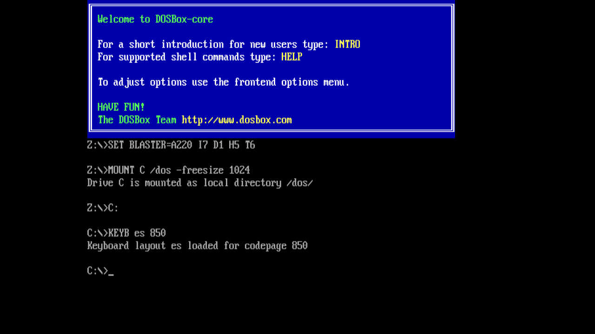

# BM-DOS

**DOSBox sobre Raspberry Pi sin sistema operativo.**

por [@mmoroca](https://github.com/mmoroca) y [arena.ai](https://arena.ai), 2026



BM-DOS convierte una Raspberry Pi en una máquina DOS de la época. No hay Linux, ni
escritorio, ni gestor de ventanas: la Pi arranca directamente en el intérprete de
comandos de DOS, y los programas de MS-DOS funcionan. El mismo árbol de fuentes
compila para la Pi 3, la familia Pi 4 (incluidas la 400 y la CM4) y la Pi 5.

---

## Índice

- [Qué es](#qué-es)
- [Hardware](#hardware)
- [Inicio rápido](#inicio-rápido)
- [Entorno de compilación](#entorno-de-compilación)
- [Compilar desde cero](#compilar-desde-cero)
- [Ponerlo en una tarjeta](#ponerlo-en-una-tarjeta)
- [Configuración: `boot.conf`](#configuración-bootconf)
- [Configuración: los otros dos ficheros](#configuración-los-otros-dos-ficheros)
- [Teclas](#teclas)
- [El panel de estado](#el-panel-de-estado)
- [Cómo funciona](#cómo-funciona)
- [Pruebas](#pruebas)
- [Problemas típicos](#problemas-típicos)
- [Estructura del repositorio](#estructura-del-repositorio)
- [Licencia](#licencia)
- [Créditos](#créditos)
- [Agradecimientos](#agradecimientos)

---

## Qué es

Una Raspberry Pi arranca el entorno **Circle** (bare metal: sin sistema operativo), que levanta el
framebuffer, el USB, la tarjeta SD y un dispositivo de audio. Sobre eso corre
**DOSBox-core** - el fork libretro de DOSBox - gobernado por un frontend escrito
para este port. La imagen del núcleo es un único `kernel8-rpi4.img` de unos 4 MB.

Lo que funciona hoy:

| Función | Estado |
|---|---|
| Intérprete de DOS, unidades `C:`/`D:` desde la tarjeta | funciona |
| `dosbox.conf` leído de la tarjeta, `[autoexec]` respetado | funciona |
| Modos de texto y gráficos VGA, escalado y relación de aspecto | funciona |
| Sound Blaster, Adlib, altavoz del PC (HDMI o jack de 3,5 mm) | funciona |
| Recompilador dinámico (JIT), seleccionable desde `dosbox.conf` | funciona |
| Teclado, ratón y mandos USB (HID) | funciona |
| Governor del reloj ARM, 600 MHz en el prompt de DOS | funciona |
| Panel de estado, capturas de pantalla, apagado seguro | funciona |
| MIDI / MT-32 | no implementado (no hay emulación de MT-32 sin sistema operativo) |
| CD-ROM, red, IPX, módem | no implementado |
| Voodoo / 3dfx | no implementado |

La máquina emulada es un 486DX2-66 (23880 ciclos) salvo que `dosbox.conf` diga
otra cosa.

## Hardware

Cualquier Raspberry Pi desde la 3 en adelante, y los modelos posteriores en la
medida en que Circle los soporte. La placa se elige al compilar con `RASPPI`, y el
mismo árbol de fuentes cubre todas:

| `RASPPI` | Placas | Imagen del núcleo |
|---|---|---|
| `3` | Pi 3, Pi 3+, Zero 2 W | `kernel8.img` |
| `4` | **por defecto**: Pi 4, Pi 400, CM4, CM5 | `kernel8-rpi4.img` |
| `5` | Pi 5 | `kernel_2712.img` |

El mínimo es una placa con 1 GB de RAM; 2 GB o más es cómodo, porque el
framebuffer y la memoria del emulador salen del mismo montón.

Aparte de la placa:

* Tarjeta microSD de 2 GB o más, FAT32, una sola partición. **Una vez escrita la
  tarjeta es FAT32 corriente**, así que los juegos, `dosbox.conf` y `boot.conf` se
  editan desde cualquier ordenador - Windows, macOS o Linux - sin herramientas
  especiales. El anfitrión Linux sólo hace falta para *compilar* el núcleo y para
  *escribir* la tarjeta la primera vez.
* Pantalla HDMI y teclado USB. Ratón y mando son opcionales.
* No hace falta ventilador: el governor mantiene el SoC a 600 MHz siempre que no
  se esté emulando nada.

Probado en una **Raspberry Pi 400** con una pantalla HDMI de 1080p.

## Inicio rápido

Si la máquina ya está preparada:

```bash
make                       # compila kernel8-rpi4.img
make card-check            # muestra qué cambiaría en la tarjeta, sin escribir
make card-update           # escribe en una tarjeta que ya arranca, conservando dos/
```

Desde un checkout vacío, la secuencia completa está en [Compilar desde
cero](#compilar-desde-cero). Lleva entre 30 y 90 minutos, la mayor parte
compilando libc++.

## Entorno de compilación

### Anfitrión

Una máquina Linux x86_64. Probado en CachyOS/Arch; los comandos de Debian/Ubuntu
van al lado.

| Paquete | Para qué |
|---|---|
| `git` | traer Circle, circle-stdlib y DOSBox-core |
| `make` | la compilación |
| `python3` | el check de listas de fuentes y los tests generados |
| `mtools`, `dosfstools` | escribir la tarjeta FAT32 |
| `parted` | particionar la tarjeta |
| `curl` | descargar el toolchain |

```bash
# Arch / CachyOS
sudo pacman -S --needed base-devel git python mtools dosfstools parted curl

# Debian / Ubuntu
sudo apt install build-essential git python3 mtools dosfstools parted curl
```

Unos 8 GB de disco para los árboles de compilación y el toolchain.

### Toolchain cruzado

**Arm GNU Toolchain para el objetivo AArch64 ELF bare metal (sin sistema operativo)**, prefijo
`aarch64-none-elf-`, versión **15.2 o superior**. No es negociable: el libc++ que
compila circle-stdlib usa builtins del compilador (`__is_array`, `__has_feature`,
`__builtin_operator_new`) que GCC 13 y 14 no tienen, y la compilación muere miles
de líneas dentro de libc++ con errores que parecen una librería rota.

Desde <https://developer.arm.com/downloads/-/arm-gnu-toolchain-downloads>, o:

```bash
mkdir -p opt && cd opt
curl -LO https://developer.arm.com/-/media/Files/downloads/gnu/15.2.rel1/binrel/arm-gnu-toolchain-15.2.rel1-x86_64-aarch64-none-elf.tar.xz
tar -xf arm-gnu-toolchain-15.2.rel1-x86_64-aarch64-none-elf.tar.xz
```

Vive **dentro del proyecto**, en `opt/`, que está en `.gitignore`. No se escribe
nada en `$HOME` ni se toca `$PATH`: el `Makefile` pone
`opt/arm-gnu-toolchain-*/bin` delante para su propia invocación, y `make version`
dice qué compilador está usando. Para usar un toolchain de otro sitio:

```bash
make TOOLCHAIN_DIR=/ruta/con/arm-gnu-toolchain-*
```

**No** uses el paquete `gcc-aarch64-linux-gnu` ni el `aarch64-none-elf-gcc` de la
mayoría de las distribuciones: son GCC 13/14 y la compilación falla.

## Compilar desde cero

```bash
git clone https://github.com/mmoroca/baremetaldos.git
cd baremetaldos          # el directorio se llama como el repositorio
chmod +x scripts/*.sh scripts/hostcheck/*.sh
```

El `chmod` no es opcional y conviene saber por qué: git sólo conserva el bit de
ejecución en los ficheros con los que se guardó, y una copia que lo haya perdido
produce scripts que contestan `Permission denied` - o, en un sistema de ficheros
que no guarda ese bit, scripts que no arrancan. Hacerlo una vez después de clonar
no cuesta nada y elimina una clase de fallos confusos.

**1. Traer y compilar Circle, newlib y libc++** (30-60 minutos, la parte larga):

```bash
./scripts/setup.sh              # Pi 3, familia Pi 4 o Pi 5 segun RASPPI, por defecto 4
RASPPI=3 ./scripts/setup.sh     # Pi 3 / Zero 2 W
RASPPI=5 ./scripts/setup.sh     # Pi 5
```

El script comprueba el toolchain, clona `circle-stdlib` con sus submódulos en
`third_party/`, lo configura con libc++, un núcleo de 64 MB y soporte
multinúcleo, y lo compila. Si falta el toolchain, imprime los dos comandos que lo
descargan en `opt/` y se detiene.

**2. Traer DOSBox-core** en la revisión fijada:

```bash
make fetch
make check-rev        # confirma la revisión que espera el port
```

**3. Compilar la imagen del núcleo:**

```bash
rm -rf build
make -j"$(nproc)"
```

El resultado es `kernel8-rpi4.img` en la raíz (con `RASPPI=3` es `kernel8.img`, con
`RASPPI=5` es `kernel_2712.img`). `make version` imprime el sello de la
instantánea, el hash del Makefile y el estado de `third_party/`.

Para el jack de 3,5 mm en lugar del audio por HDMI:

```bash
make AUDIO_DEVICE=pwm
```

### El ARM stub de la Pi 4

En una Pi 4, Circle necesita `armstub8-rpi4.bin` junto a `config.txt`.
`make-sd.sh` descarga el firmware, compila el stub y lo copia, así que una tarjeta
escrita con ese script no necesita nada más. Si estás montando la tarjeta a mano:

```bash
make -C third_party/circle-stdlib/libs/circle/boot armstub64
cp third_party/circle-stdlib/libs/circle/boot/armstub8-rpi4.bin sd/
```

## Ponerlo en una tarjeta

Dos caminos, y el orden importa: **primero se escribe una tarjeta desde cero, y
después se actualiza** sin destruir nada. Los dos necesitan la tarjeta insertada
en el ordenador y **montada** - los scripts aceptan un dispositivo de bloque
(`/dev/sdX`) o un punto de montaje, y en Windows se usa una herramienta como
Rufus, balenaEtcher o Win32DiskImager para la primera escritura.

> **Averigua primero qué dispositivo es.** `/dev/sdX` en los comandos de abajo es
> la tarjeta, no el disco duro. `lsblk` (Linux) o `diskutil list` (macOS) antes,
> siempre; una letra equivocada aquí destruye el disco equivocado.

### 1. Una tarjeta desde cero

**Destructivo: particiona y formatea el dispositivo.** Por eso no es un objetivo de
`make`: así nunca queda a una pulsación de `make`.

```bash
./scripts/make-sd.sh --stage ./sdcard     # preparar el árbol primero, mirarlo
sudo ./scripts/make-sd.sh /dev/sdX        # y luego escribirlo en la tarjeta
```

`--stage` merece el paso extra: deja en un directorio local exactamente los
ficheros que necesita una tarjeta, para revisarlos antes de particionar nada.

El script particiona la tarjeta como **una única partición FAT32**, copia el
núcleo, los ficheros del firmware y el contenido de `sd/`, y la deja lista para
arrancar. El reparto es:

```
/            boot.conf, config.txt, cmdline.txt, kernel8-rpi4.img, firmware
/dosbox/     dosbox.conf
/dos/        juegos y programas - vacío; los pones tú
```

Se desmonta la tarjeta, se pone en la Pi y se enciende. El emulador arranca en el
prompt `C:`.

### 2. Una tarjeta que ya arranca

Es el camino de cada día cuando se ha compilado un núcleo nuevo. Sustituye el
núcleo, añade lo que falte y **nunca borra** `dos/`, `dosbox/saves` ni nada
editado a mano:

```bash
make card-check      # imprime el plan, no escribe nada
make card-update     # lo hace
```

o directamente, con la tarjeta montada:

```bash
sudo ./scripts/update-sd.sh /dev/sdX
sudo ./scripts/update-sd.sh --dry-run /dev/sdX
./scripts/update-sd.sh --stage ./sdcard     # preparar un directorio
```

### 3. A partir de ahí, cualquier ordenador sirve

La tarjeta es FAT32 corriente, sin estructura especial, así que una vez escrita se
edita desde **cualquier** máquina - Windows, macOS o Linux:

* `boot.conf`, `config.txt` y `cmdline.txt` están en la raíz y son texto;
* `dosbox.conf` es texto en `/dosbox/`, y su sección `[autoexec]` es donde se
  montan las unidades;
* los juegos y programas son ficheros y directorios en `/dos/`, y se copian como
  cualquier otro fichero.

Para nada de eso hace falta un anfitrión Linux, ni el toolchain, ni los scripts. La
máquina Linux sólo se necesita para compilar el núcleo y para escribir una tarjeta
la primera vez.

## Configuración: `boot.conf`

`/boot.conf`, en la primera partición de la tarjeta, guarda los ajustes que
pertenecen al **port** y no a DOSBox. Lo lee el propio núcleo, antes de montar
nada, y por eso es un fichero aparte: el modo de pantalla tiene que estar elegido
antes de que exista el framebuffer, y `dosbox.conf` lo parsea DOSBox mucho
después.

El formato es una línea `clave = valor`, `#` empieza un comentario, las claves
desconocidas se ignoran **y se avisan en el log**, y que el fichero no exista no
es un error: todo valor tiene un defecto. Un fichero mal escrito no puede impedir
que la placa arranque; es deliberado.

### `display = ANCHOxALTO`

El framebuffer en el que dibuja el emulador. Todo lo que produce DOSBox se convierte
y se copia aquí, así que el coste por frame es proporcional a esto y no al tamaño
de la pantalla emulada.

| Valor | Cuándo |
|---|---|
| `1920x1080` | nativo en una pantalla 1080p; el máximo de píxeles a copiar |
| `1280x720` | **por defecto**: 1,5x exacto en 1080p, ~55 MB/s a 60 Hz |
| `1024x768` | monitores 4:3 y juegos de la era VGA |
| `800x600` | una Pi 3, o si 720p todavía no llega |
| `640x480` | VGA exacto, un píxel de salida por píxel emulado, sin escalador |

Si el modo se rechaza, se prueba el siguiente hacia abajo automáticamente, así que
un valor no soportado no puede dejar una pantalla negra.

> **Nota sobre el ancho del panel de estado.** El panel ocupa 118 caracteres en su
> estado típico y hasta 133 con todos los campos al máximo, que son 1064 píxeles a
> 8 px por carácter. En un modo más estrecho de 1088 se recortan los campos de la
> derecha, y el último es `drop`. Usa 1280x720 o más para ver la línea entera.

### `cpu_max_mhz = N`

El techo que puede usar el governor del reloj, en MHz. El governor tiene tres
niveles propios - 600 en el prompt de DOS, 1500 para los ciclos por defecto de
DOSBox, 2000 sólo cuando los frames no caben - y esto limita la parte alta de ese
rango. `0` (por defecto) deja que el firmware decida lo que la placa puede hacer.
Es un techo, no una velocidad fija: el governor sigue bajando a 600 cuando no hay
nada que ejecutar.

### `mode = auto | performance | powersave`

Se parsea y se valida, pero todavía no se aplica: hacerlo significaría pisar al
governor, y eso no está en este hito. Cualquier valor distinto de `auto` produce un
aviso en el log.

### Lo que deliberadamente **no** está en `boot.conf`

* **El ritmo de frames.** El core anuncia la frecuencia de refresco de su propio
  modo de vídeo y el port la obedece. Forzar un número aquí sería pelearse con la
  emulación: un modo de texto de DOS va a 70 Hz, y clavarlo a 60 hace que la
  máquina emulada corra un 17 % más lenta.
* **La relación de aspecto y el escalado.** Los decide el core (4:3 para todo lo
  que importa) y el escalador los respeta.
* **El reloj de la CPU.** Eso es trabajo del governor, y fijar `arm_freq` en
  `config.txt` le quitaría la decisión.

## Configuración: los otros dos ficheros

`sd/dosbox.conf` es un fichero de configuración normal de DOSBox y sigue sus
reglas, incluida `[autoexec]`, que es donde se montan las unidades. Dos cosas
merecen repetirse aquí:

* **`[cpu] cycles` es lo que decide si un juego es jugable.** Los valores que
  importan son los de la documentación de DOSBox: 6075 para un 386DX-33, 12010
  para un 486DX-33, 23880 para un 486DX2-66 (el valor por defecto), 40072 para un
  Pentium-75.
* **`core = auto|dynamic|normal`** elige el JIT. `auto` usa el intérprete en modo
  real y pasa al recompilador dinámico en modo protegido, que es el valor por
  defecto y el más rápido para casi todo. `normal` fuerza el intérprete y sirve
  para comparar comportamientos.

`sd/config.txt` y `sd/cmdline.txt` pertenecen a **Circle**, no a DOSBox. Eligen la
imagen del núcleo según el modelo de Pi, fijan el modo HDMI, habilitan el
subsistema de audio y ajustan el nivel de log. `config.txt` no fija `arm_freq` a
propósito: el reloj es del governor.

## Teclas

| Tecla | Qué hace |
|---|---|
| `PetSis` | mostrar / ocultar el panel de estado |
| `Ctrl+Alt+PetSis` | reiniciar la placa |
| `Ctrl+F9` | apagar de forma segura; después se puede cortar la corriente |
| `Alt+Pause` | pausar / reanudar la máquina emulada |
| `Ctrl+F5` | captura de pantalla en `/DOSBOX/SHOTnnnn.BMP` |
| `Ctrl+F11` / `Ctrl+F12` | ciclos emulados, 2000 por pulsación |

Cortar la corriente **no** es una forma segura de parar la máquina: el FAT de la
tarjeta y la caché de escritura de la propia SD pueden dejar `dosbox.conf`, un
montaje o un fichero de partida a medio escribir, y en una Pi sin sistema operativo no hay
comprobación de sistema de ficheros que lo arregle después. `Ctrl+F9` vacía la
tarjeta, lo dice en el panel y sólo entonces dice que se puede cortar. Si el
vaciado falla, dice eso en su lugar, con el código de error de la propia tarjeta.

## El panel de estado

`PetSis` muestra una línea en una franja al pie de la pantalla sobre la que el
emulador nunca dibuja. Es un diagnóstico, así que viene apagado.

```
Pi 400  4 cores  600 MHz  43C  L2/3 idle idle   pace 70/70 w62% bd70 dup 0   fr 8200us  HDMI 1397/5292  drop 0
└─┬──┘  └──┬──┘  └──┬───┘  └┬┘  └──────┬──────┘   └───────────┬────────────┘   └──┬──┘  └────┬─────┘  └──┬─┘
  placa  núcleos reloj    temp   governor            ritmo y avances        coste del frame audio  descartes
```

### `pace R/W` - lo dibujado frente a lo que el modo refresca

`R` es el número de imágenes que llegaron al callback de vídeo por segundo; `W` es
la frecuencia que el core anunció para el modo actual. **Son dos tasas, no un
objetivo y un resultado**, así que la fracción no es un porcentaje de éxito: un
juego que va perfecto en un modo de 60 Hz imprime 60/60, y el mismo juego igual de
perfecto en 70 Hz imprime 70/70.

| En pantalla | Significado |
|---|---|
| `pace 70/70` | el modo pide 70 y se presentan 70 |
| `pace 34/70` | el modo pide 70 y sólo se producen 34: la máquina no llega, o el juego va marcado por otra cosa |
| `pace 24/70 dup 46` | judder: sólo un tercio de los frames son nuevos, el resto son repeticiones |
| `pace 70/70` con `fr 45ms` | bien marcado, pero cada frame es caro |

**La regla: `R` debe ser igual a `W`, y `W` debe ser la tasa del modo.**

### `bd N` - cuántas veces avanzó la máquina emulada

`pace` cuenta **imágenes**. `bd` cuenta **bordes de frame que cruzó la máquina
emulada**, por segundo. En una máquina bien marcada los dos coinciden; la
diferencia entre ellos es lo que contesta «¿va acelerado?».

| En pantalla | Significado |
|---|---|
| `pace 70/70 bd70` | el bucle de frames es el metrónomo: cada avance produjo su imagen |
| `pace 33/70 bd70` | el emulador avanza a su ritmo y dibuja de menos: va lento, no rápido |
| `pace 33/70 bd140` | **va acelerado**: la máquina emulada avanza el doble de lo que pide su modo |
| `pace 70/70 bd70 +` | además, algunos de esos avances ocurrieron sin que el bucle los pidiera: nada en el bucle de frames puede medirlos |

### `wNN%` - cuánto del segundo se pasó esperando

La fracción del último segundo de reloj que el bucle de frames pasó esperando su
siguiente frame. Una máquina bien marcada espera la mayor parte de cada segundo
(40-90 %) y llama al emulador con el resto. **0 % significa que el bucle no está
marcando el paso**, pero también ocurre legítimamente cuando un frame cuesta más
que el periodo del modo, así que nunca se lee solo.

### `fr NNus` - el coste de una llamada a `retro_run()`

Microsegundos por llamada. Es lo que distingue «el core produce un frame por
llamada» de «el core produce seis»: en una máquina rápida es la diferencia entre
sobrar tiempo y no tener ninguno.

### `lm/max overNNN` - el governor del reloj

Dos niveles de tres (los de la placa), luego una palabra:

| Palabra | Significado |
|---|---|
| `idle` | en pantalla no cambia nada; no se justifica ningún reloj |
| `comf` | los frames van holgados: el reloj puede bajar |
| `busy` | por encima del presupuesto y hay un nivel por encima: el governor está subiendo |
| `max` | por encima del presupuesto en el nivel más alto: ningún reloj lo arreglará |
| `-` | entre holgura y sobrecoste: no hay evidencia en ningún sentido |

`overNNN` es cuántos frames consecutivos han ido por encima del presupuesto. Un
`max` sobre el prompt de DOS significa que la máquina cree que está trabajando
mientras la imagen no cambia, y eso es un fallo que merece un informe.

### `dup N`, `drop N`, `HDMI n/m`

`dup` son los frames que el core pidió repetir (la misma imagen otra vez) por
segundo; `drop` son muestras de audio descartadas por segundo; `HDMI 1397/5292` es
la cola del dispositivo de audio en frames de hardware. Las constantes son
normales. Un `drop` que sube sin parar mientras el sonido entrecorta, no.

## Cómo funciona

El port es un **frontend libretro** para un único core. DOSBox-core se escribió
como core libretro, así que espera un anfitrión que registre callbacks (vídeo,
audio, entrada, entorno, log) y llame a `retro_run()` una vez por frame. Todo lo
que hay debajo es de este port:

* `src/kernel.cpp` - la aplicación Circle: orden de arranque, bucle de frames, el
  pacer, el panel de estado.
* `src/platform/bare_libretro.cpp` - el frontend libretro: callbacks, opciones,
  teclas, apagado.
* `src/platform/bare_video.cpp` - framebuffer, escalado, relación de aspecto, los
  huecos del panel, capturas.
* `src/platform/bare_audio.cpp` - salida HDMI y PWM, remuestreo.
* `src/platform/bare_thread.cpp` - el sustituto monohilo del hilo del emulador de
  DOSBox-core, sobre el planificador cooperativo de Circle.
* `src/platform/bare_sysinfo.cpp` y `governor_policy.h` - el governor del reloj
  ARM, su tabla de niveles y sus reglas de decisión.
* `src/platform/bare_dynarec.cpp` - la caché de código que necesita el JIT y que
  el hardware sin sistema operativo no da por sí solo.
* `src/platform/bare_storage.h` - el vaciado de la tarjeta, que es lo que hace de
  `Ctrl+F9` una forma segura de parar la máquina.

Tres decisiones explican el resto:

1. **El ritmo es el del modo, no 60.** Con `RUN_SYNC` el core vuelve de
   `retro_run()` una vez por frame emulado, así que un modo de texto de 70 Hz
   vuelve 70 veces por segundo. Marcarlo a 60 haría correr la máquina un 17 % más
   rápido, y ningún número de ciclos lo arregla, porque los ciclos deciden cuánto
   trabajo cabe en un frame, no cuántos frames ocurren por segundo.
2. **El reloj se decide en marcha.** El governor arranca a 600 MHz, mide el coste
   de cada frame contra el presupuesto que implica el modo, y sube sólo cuando los
   frames no caben - y sólo mientras la imagen cambia de verdad.
3. **Todo lo que se puede probar en un PC se prueba en un PC.** La compilación
   tiene más de 300 comprobaciones en el anfitrión, contra dobles de Circle y
   FatFs, porque un check que necesita la placa es un check que se ejecuta dos
   veces por semana.

## Pruebas

```bash
make check-host      # todo lo que corre en el anfitrión, sin toolchain
make check           # sólo rutas de inclusión y cabeceras
make distclean       # borra build/ y third_party/ (conserva opt/)
```

`check-host` es un conjunto de programas y scripts pequeños:

| Objetivo | Qué comprueba |
|---|---|
| `check-platform` | los símbolos que promete `bare_env.h` frente a los que definen los ficheros de plataforma |
| `check-kernel` | que `kernel.cpp` compile contra un doble de circle-stdlib |
| `check-bootconf` | el parser de `/boot.conf`, con ficheros que la gente escribe de verdad |
| `check-scaling` | relación de aspecto y uso de pantalla del escalador, por modo |
| `check-dynarec` | el recorrido de tablas de página que hace ejecutable la caché del JIT |
| `check-coreopts` | los ciclos de CPU que el frontend le pide al core |
| `check-resample` | el filtro de imagen, contra patrones con respuesta conocida |
| `check-storage` | la secuencia de vaciado de la tarjeta, contra un FatFs falso |
| `check-governor` | la tabla de niveles del governor y sus reglas de decisión |
| `check-portorder` | cuándo puede anunciarse el puerto de juegos |
| `check-dynarec-hook` | el hook del JIT, compilado contra las fuentes reales del core |
| `check-sources` | la lista de fuentes de este Makefile frente a la de DOSBox-core |

`check-dynarec-hook` y `check-sources` necesitan `third_party/dosbox-core`; sin él
informan **OMITIDO con estado distinto de cero**, a propósito. Un check que no
puede mirar no es un check que pasa.

## Problemas típicos

**`make` dice `Config.mk not found`.** Circle no está compilado. Ejecuta
`./scripts/setup.sh`.

**La compilación muere dentro de libc++ con errores sobre `__is_array` o
`__builtin_operator_new`.** El toolchain es viejo. Tiene que ser GCC 15.2 o
superior; ver [Entorno de compilación](#entorno-de-compilación). `make version` dice
qué compilador está usando el build.

**Un juego va demasiado lento.** Es la CPU emulada, no el port. Prueba
`core = dynamic` en `dosbox.conf`, o baja `cycles`; a un juego que espera un 386 no
le ayudan 23880 ciclos y sí le perjudica que el audio se quede atrás.

**La imagen no llena la pantalla.** Es la relación de aspecto respetándose. Un modo
320x200 es 4:3 en el hardware original, y estirarlo a 16:9 está mal. Usa
`display = 640x480` si quieres VGA exacto.

**No hay sonido por HDMI pero sí por el jack.** El problema es la pantalla, no el
port: `hdmi_drive=2` ya está en `config.txt`, y el port elige el jack cuando el
HDMI no tiene altavoces. `make AUDIO_DEVICE=pwm` fuerza el jack.

**El panel de estado se recorta por la derecha.** El modo es más estrecho de 1088
píxeles; ver [la nota sobre el ancho del panel](#display--anchoxalto).

**Va acelerado y los ciclos no lo arreglan.** Mira `bd` en el panel: si está por
encima de `W`, la máquina emulada avanza más rápido que su propio modo y la
evidencia está en el panel, no en el número de ciclos. Incluye la línea entera del
panel en cualquier informe.

## Estructura del repositorio

```
Makefile                  compilación, checks y objetivos de tarjeta
DOSBOX_REV                la revisión fijada de DOSBox-core
LICENSE                   el texto de la GPL-3.0, literal y sin modificar
NOTICE                    copyright, por qué GPL-3.0, obra combinada, agradecimientos
README.md                 el README principal (inglés)
README.es.md              este mismo documento, en español
src/kernel.cpp            la aplicación Circle y el bucle de frames
src/kernel.h
src/main.cpp              punto de entrada
src/platform/             todo lo que habla con Circle, FatFs o el firmware
src/dosbox-stub/          los pocos símbolos POSIX y MIDI que DOSBox necesita y
                          que el port tiene que aportar
scripts/                  puesta a punto, compilación, tarjetas, checks del host
sd/                       los ficheros que van a la tarjeta, tal como se entregan
```

`third_party/`, `build/`, `opt/` y `sdcard/` se generan y están en `.gitignore`.

## Licencia

**GNU General Public License versión 3.0**, en `LICENSE`.

Una licencia más permisiva no está disponible para la imagen, y no por elección: el
núcleo enlaza estáticamente Circle (GPL-3.0) y DOSBox-core (GPL-2.0-o-posterior),
así que el binario combinado tiene que ser GPL-3.0 y, si se distribuye, su código
fuente tiene que estar disponible. Este repositorio es ese código. `NOTICE` tiene
la línea de copyright, el razonamiento y la licencia de cada componente que acaba en
la imagen; `LICENSE` es el texto literal de la GPL-3.0, y nada más.

## Créditos

* **DOSBox-core** - el equipo de DOSBox, y Nikos Chantziaras por el port a
  libretro. <https://github.com/libretro/dosbox-core>
* **DOSBox** - el equipo de DOSBox. <https://www.dosbox.com>
* **Circle** - Rene Stange, el entorno C++ sin sistema operativo para Raspberry Pi.
  <https://github.com/rsta2/circle>
* **circle-stdlib** - Stephan Muehlstrasser.
  <https://github.com/smuehlst/circle-stdlib>
* Todo lo escrito para este port - **@mmoroca** y [arena.ai](https://arena.ai),
  2026.

## Agradecimientos

Inspirado por el trabajo de [@rtomasa](https://github.com/rtomasa) en Pi-DOS
(<https://github.com/rtomasa/Pi-DOS>), un DOSBox para Raspberry Pi bajo Linux, y el
reto propuesto por [@shaeon](https://github.com/shaeon) desarrollador de
ZXMetalCircle (<https://github.com/shaeon/ZXMetalCircle>).

No hay código copiado de ninguno de los dos proyectos. Lo que aportaron a éste es
la idea de que una Raspberry Pi puede ejecutar todo el software de un ordenador sin
un sistema operativo debajo, y la razón para intentarlo con DOSBox.
